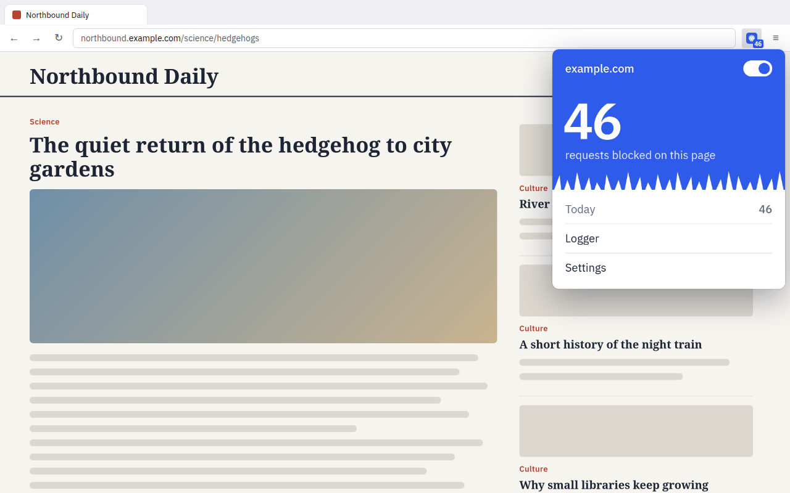
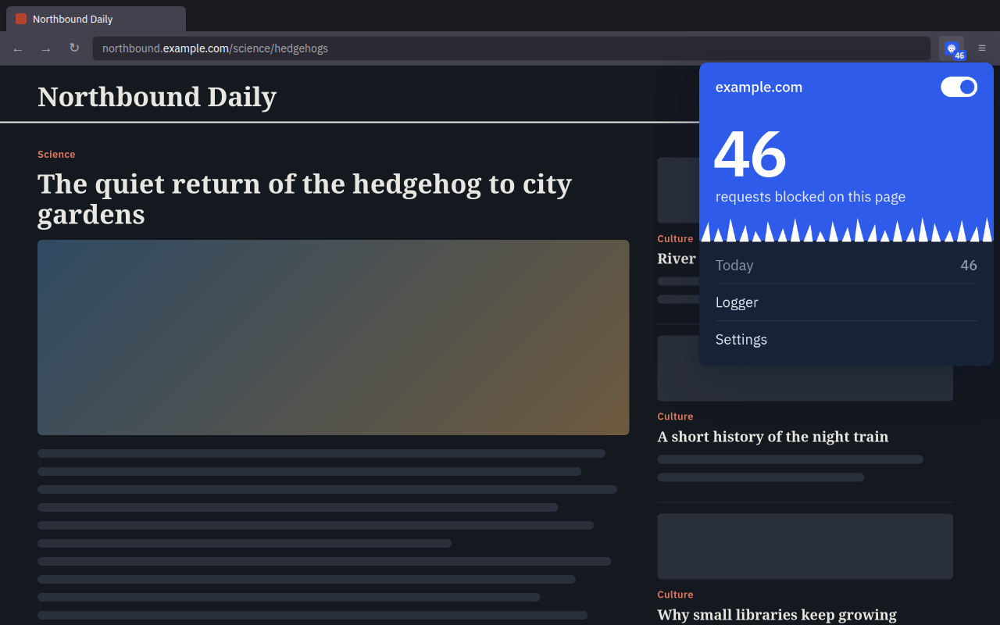

<div align="center">


# PrivaBlock

**Blocks ads and trackers in Firefox and Chromium browsers. No account, no analytics.**

[](https://github.com/TNFX1/PrivaBlock/actions/workflows/build.yml)
[](LICENSE)

[Install](#install) · [How it works](#how-it-works) · [Privacy](#privacy) · [Build](#build) · [Türkçe](#türkçe)

 

</div>

## What it does

- **Blocks ads and trackers** with well-known filter lists: uBlock filters, EasyList, EasyPrivacy, HaGeZi, AdGuard.
- **Hides leftover ad boxes** on pages (element hiding), including YouTube's ad slots, and runs the lists'
  procedural rules (`:has-text()`, `:upward()`, `:remove()`, `:style()`…).
- **Scriptlets**: the lists' `+js()` rules that defuse anti-adblock walls, pop-ups and cookie banners
  inside the page (PrivaBlock's own implementation of the common ones).
- **Element picker**: click any part of a page to hide it from then on (popup, or <kbd>Alt+Shift+H</kbd>).
- **Three profiles**: Light, Balanced (default) and Strict, or pick lists one by one.
- **Your own rules** in Adblock syntax, and any public filter list by URL.
- **Shows what it blocked**: a count on the toolbar icon, and in the popup the page's total with a row
  of quills, one per blocked request (Firefox also shows today's total).
- **Turn it off per site** from the switch in the popup (or a keyboard shortcut you set).
- **Backup**: save your settings, lists and filters to a file and restore them in another browser.
- **Logger** that shows what was blocked on a tab and which list blocked it.
- **Optional fingerprinting protection** on Firefox, off by default.
- English and Turkish; light and dark theme follow your system.

## Install

| Browser | How |
| --- | --- |
| Firefox (desktop and Android) | [addons.mozilla.org/firefox/addon/privablock](https://addons.mozilla.org/firefox/addon/privablock/) |
| Chrome, Brave, Edge, Vivaldi, Helium… | Not in the Chrome Web Store yet. Download `privablock-chromium-*.zip` from [Releases](https://github.com/TNFX1/PrivaBlock/releases), unzip it, open `chrome://extensions`, turn on *Developer mode*, *Load unpacked*, pick the folder. |

## How it works

PrivaBlock works differently in the two browser families, because they give extensions different tools.

| | Firefox | Chromium |
| --- | --- | --- |
| Engine | Every request is checked by PrivaBlock (blocking `webRequest`, Manifest V2) | The browser applies rule sets compiled from the lists (`declarativeNetRequest`, Manifest V3) |
| Filter lists | Downloaded from their publishers, refreshed daily | Built into the extension, refreshed with each PrivaBlock release (rebuilt weekly) |
| Your filters & custom lists | Unlimited | Up to the browser's 30,000-rule limit (you're told when it's reached) |
| Logger | Every request, allowed or blocked, with the matching filter | Blocked requests and the list that blocked them (Chromium doesn't report the address) |
| Blocked count | Counted by PrivaBlock as it blocks | Toolbar: the browser's own count. Popup: counted live from blocked-request events (`webRequest`, read-only), which also include requests blocked by other content blockers |
| Fingerprinting protection | Optional: turns on Firefox's own *resist fingerprinting* (off by default) | — |

Supported filter syntax: network filters (`||example.com^`, `$third-party`, `$domain=`, resource types,
`$important`, `@@` exceptions), hosts files, site-specific element hiding (`example.com##.ad`), procedural
cosmetics (`:has-text`, `:upward`, `:matches-css`, `:xpath`, `:remove`, `:style`…, also AdGuard's `#?#`)
and scriptlets (`##+js(…)`: set-constant, abort-on-property-read/write, abort-current-script, json-prune,
json-prune-fetch/xhr-response, json-edit (uBO's legacy JSONPath), no-setTimeout-if, no-fetch-if, no-xhr-if,
set-cookie, remove-attr and more, with their usual aliases). Redirects, regex filters, HTML filtering,
`v2:` JSONPath and generic hiding rules are skipped.

As in uBlock Origin, filters that rewrite what a page receives or runs are accepted only from uBlock
Origin's own lists (uBlock filters, Quick fixes, Unbreak, Privacy), never from other lists, custom lists
or My filters: the `trusted-*` scriptlets, `replace-node-text`, and `$replace=` (Firefox only, it rewrites
response bodies). These are what keep video ads off YouTube.

Scriptlets run in the page at `document_start`. The lists' scriptlets are registered ahead of time for the
sites they name (Firefox: `contentScripts.register`; Chromium: per-list scripts built with the extension).
On Chromium, scriptlets in your own filters and custom lists arrive by message, so they can run after a
page's first scripts.

## Privacy

PrivaBlock has no servers and collects nothing. Settings, statistics and the logger stay in your browser.
The only network requests it makes are downloads of the filter lists you enabled, sent straight to their
publishers (on Chromium only for your custom lists). See [PRIVACY.md](PRIVACY.md).

## Build

Needs Node.js 22 or newer. No dependencies.

```bash
npm test                    # unit tests: parsing, matching, Public Suffix List, rule conversion
npm run build               # dist/firefox and dist/chromium (+ zips when `zip` is installed)
node tools/build.mjs --offline chromium    # rebuild from the lists already downloaded to .cache/
node tests/browser/firefox-smoke.mjs       # real Firefox (headless): blocking, hiding, site switch
node tests/browser/chromium-smoke.mjs --browser chromium   # same in a Chromium browser
```

```
src/core/       filter parsing, matching, Public Suffix List, DNR conversion (no browser APIs)
src/firefox/    Firefox background (MV2) and manifest
src/chromium/   Chromium service worker (MV3) and manifest
src/content/    element hiding, procedural filters, scriptlets (page world), element picker
src/ui/         popup, settings, logger
src/_locales/   en, tr
```

## Türkçe

PrivaBlock, Firefox ve Chromium tabanlı tarayıcılarda (Chrome, Brave, Edge, Helium…) reklamları ve
izleyicileri engeller. Hesap, sunucu ve analitik yoktur; ayarlar ve istatistikler tarayıcınızda kalır.

- uBlock, EasyList, EasyPrivacy, HaGeZi ve AdGuard listeleri; Hafif, Dengeli ve Sıkı profiller
- Sayfadaki boş reklam kutularını gizleme (YouTube dahil), listelerdeki gelişmiş (procedural) kurallar
- Reklam engelleyici uyarılarını, açılır pencereleri ve çerez bildirimlerini sayfanın içinde etkisiz
  bırakan scriptlet kuralları (`+js()`)
- Öğe seçici: sayfada istediğiniz yere tıklayıp gizleyin (açılır pencere veya <kbd>Alt+Shift+H</kbd>)
- Ayarları, listeleri ve filtreleri dosyaya yedekleme ve geri yükleme
- Kendi kurallarınız ve URL ile eklenen özel listeler
- Engellenen istek sayısı araç çubuğu simgesinde ve açılır pencerede; her engellenen istek için bir diken
- Açılır penceredeki anahtarla site bazında kapatma
- Firefox'ta isteğe bağlı parmak izi koruması (varsayılan olarak kapalı)
- Neyin engellendiğini gösteren kayıt defteri
- Türkçe ve İngilizce arayüz, sisteme uyan açık/koyu tema

Firefox (masaüstü ve Android) için: [addons.mozilla.org](https://addons.mozilla.org/firefox/addon/privablock/). Chromium tabanlı
tarayıcılar için yukarıdaki [Install](#install) tablosuna bakın.

## License

[MPL-2.0](LICENSE). The bundled IBM Plex Sans font is under the SIL Open Font License
([src/ui/fonts/LICENSE-OFL.txt](src/ui/fonts/LICENSE-OFL.txt)). Filter lists belong to their authors and
keep their own licenses.
